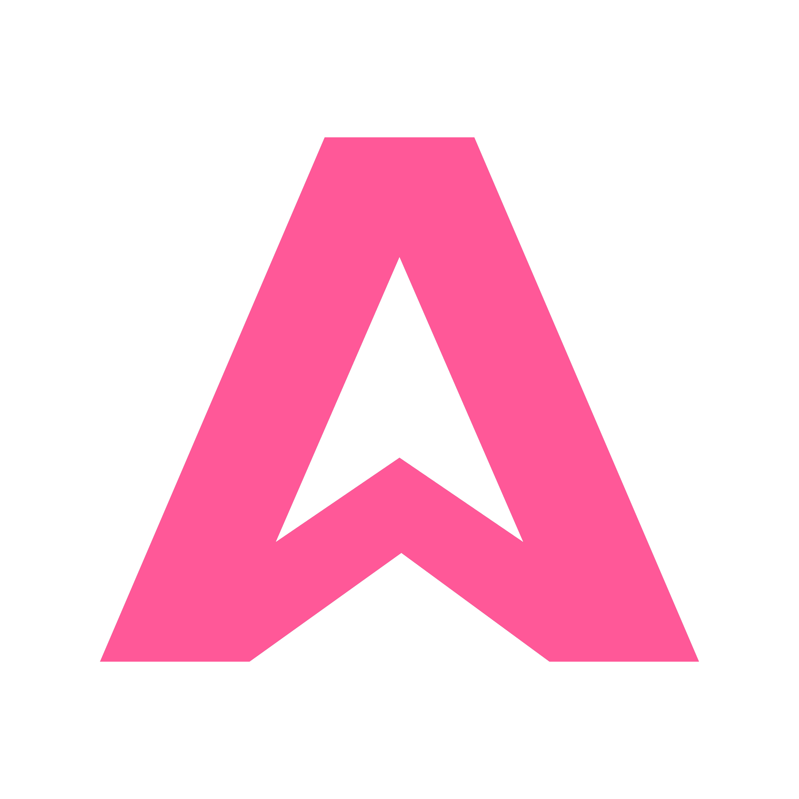
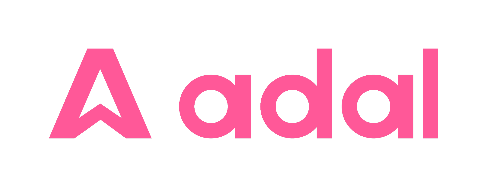

  

# AdaL

  

**AdaL is your automation-first agent harness. Every coding agent can build, but only AdaL does GTM directly from your codebase.**

It runs in your terminal, carries each issue from direction to tested PR, and works with Claude, GPT, Gemini, GLM, Kimi, DeepSeek, MiniMax, and local models.

## Links

- **Homepage:** [adalagent.ai](https://adalagent.ai)
- **Docs:** [docs.sylph.ai](https://docs.sylph.ai)
- **Install:** `curl -fsSL https://adal.sylph.ai/install.sh | bash`
- **CLI repo:** [SylphAI-Inc/adal-cli](https://github.com/SylphAI-Inc/adal-cli) — report issues, share what you build, contribute skills
- **Skills marketplace:** [SylphAI-Inc/skills](https://github.com/SylphAI-Inc/skills)
- **@skills protocol:** [SylphAI-Inc/atskills](https://github.com/SylphAI-Inc/atskills)
- **Agent SDK:** [SylphAI-Inc/adal-sdk](https://github.com/SylphAI-Inc/adal-sdk)
- **X:** [@adalagent](https://x.com/adalagent) · **Discord:** [join](https://discord.com/invite/ezzszrRZvT)
